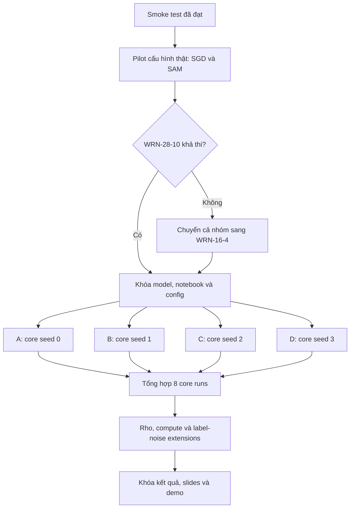

# Kế hoạch thực nghiệm đồ án CS2229 - Sharpness-Aware Minimization

## Material Passport

- Origin Skill: experiment-agent
- Origin Mode: plan
- Origin Date: 2026-10-23
- Last Updated: 2026-11-06
- Verification Status: UNVERIFIED
- Version Label: code_plan_v3

## 1. Thông tin chung

- **Môn học:** CS2229
- **Quy mô nhóm:** 4 thành viên
- **Hạn báo cáo:** 30/11/2026
- **Trạng thái thực nghiệm:** Ngày 04/11 nhóm chốt WRN-28-10 cho core matrix. Notebook `sam_reproduction_vi_v5` đã sẵn sàng cho tám core runs trên bốn branch. Cùng ngày, B hoàn tất `core_sgd_s1` và `core_sam_s1`, rồi bắt đầu `rho` ablation trên `run/rho-s1` bằng notebook stage 2 `sam_stage2_reproduction_vi_v1`. Ngày 06/11, tám core runs đã chạy xong và chờ review chéo; notebook `sam_stage2_extensions_vi_v1` sẵn sàng cho SGD 400 epochs và label noise trên ba branch `run/sgd400-s0`, `run/noise40-s2`, `run/noise80-s2`
- **Bài báo:** Foret, Kleiner, Mobahi, và Neyshabur, *Sharpness-Aware Minimization for Efficiently Improving Generalization*, ICLR 2021
- **Paper:** [OpenReview](https://openreview.net/forum?id=6Tm1mposlrM) | [arXiv](https://arxiv.org/abs/2010.01412)
- **Code chính thức:** [google-research/sam](https://github.com/google-research/sam)
- **Sản phẩm tối thiểu:** slides, source code, demo và sự tham gia thuyết trình của các thành viên

## 2. Mục tiêu thực nghiệm

Nhóm xây dựng một pipeline thống nhất để tái lập có kiểm soát một phần thí nghiệm của paper, thay vì mỗi người phát triển một notebook hoặc chọn một dataset độc lập.

Thí nghiệm chính trả lời câu hỏi:

> Trên CIFAR-10, với cùng model, data pipeline và training recipe, SAM có đạt test accuracy và generalization gap tốt hơn SGD hay không, và chi phí thời gian cùng bộ nhớ thay đổi như thế nào?

Kết quả tốt cần có:

1. Một so sánh SGD và SAM chạy thành công trên CIFAR-10.
2. Kết quả tổng hợp từ nhiều seed, không chỉ chọn run tốt nhất.
3. Ít nhất một thí nghiệm mở rộng, ưu tiên ablation theo `rho` hoặc robustness với label noise.
4. Notebook demo có thể chạy lại một cấu hình nhỏ và đọc được checkpoint của run hoàn chỉnh.

## 3. Phạm vi thực nghiệm

### 3.1 Thí nghiệm lõi

| Thành phần | Thiết lập |
|---|---|
| Dataset | CIFAR-10 |
| Model | WideResNet-28-10, đã chốt ngày 04/11 |
| Fallback | WideResNet-16-4, chỉ dùng nếu cả nhóm quyết định lại; phải ghi rõ đây là reduced reproduction |
| Augmentation | Horizontal flip, padding 4 pixels và random crop |
| Methods | SGD và SAM-SGD |
| Epochs | 200 |
| SAM radius | `rho = 0.05` |
| Seeds | 0, 1, 2, 3 |
| Primary metric | Test accuracy trung bình trên các seed |
| Metrics bổ sung | Train/test loss, train accuracy, generalization gap, wall-clock time, time/epoch và peak GPU memory |

WideResNet-28-10, CIFAR-10, basic augmentation và 200 epochs bám sát một condition trong Table 1 của paper. Nhóm dùng bốn seed để phù hợp với bốn thành viên. Nếu tài nguyên cho phép, chạy thêm seed 4 để tiến gần hơn protocol năm replica của paper.

### 3.2 Thí nghiệm mở rộng

Ưu tiên theo thứ tự:

1. `rho` ablation trên CIFAR-10.
2. SGD 400 epochs để có một đối chứng gần equal-gradient-computation với SAM 200 epochs.
3. Label noise 40%.
4. Label noise 80%.
5. CIFAR-100 chỉ thực hiện khi toàn bộ thí nghiệm trên đã hoàn tất và artifact đã được kiểm tra.

Không chia mỗi thành viên một dataset trong thí nghiệm chính. Nếu mỗi dataset chỉ có một số cấu hình riêng, kết quả khó ghép thành một so sánh thống nhất.

## 4. Phân công bốn thành viên

Điền tên thật vào cột `Thành viên` trước khi bắt đầu chạy chính thức.

| Thành viên | Core runs bắt buộc | Extension phụ trách | Trách nhiệm bổ sung |
|---|---|---|---|
| A - [Tên] | SGD seed 0; SAM seed 0 | SGD 400 epochs seed 0 nếu còn tài nguyên | Benchmark cấu hình thật, duy trì canonical notebook, khóa phiên bản và kiểm tra artifact |
| B - [Tên] | SGD seed 1; SAM seed 1 | SAM với `rho = 0.01, 0.1, 0.2`, seed 1 | Kiểm tra implementation SAM và tổng hợp đồ thị `rho` ablation |
| C - [Tên] | SGD seed 2; SAM seed 2 | SGD và SAM với 40% label noise, seed 2 | Tổng hợp learning curves, mean, standard deviation và paired differences |
| D - [Tên] | SGD seed 3; SAM seed 3 | SGD và SAM với 80% label noise, seed 2 | Tổng hợp bảng compute, chuẩn bị checkpoint và notebook demo |

### 4.1 Chuẩn bị trước core runs

Smoke test v4 trên Colab đã xác nhận cả SGD và SAM chạy đủ 5 epochs, sinh đủ artifact và load checkpoint để inference thành công. Smoke test dùng WRN-16-1 và tập con 1.024 ảnh nên không được dùng để ước lượng thời gian hoặc bộ nhớ của WRN-28-10.

Ngày 04/11, nhóm chốt chạy core matrix bằng WRN-28-10 mà không chạy pilot 2 epochs riêng. Log của mỗi core run in thời gian từng epoch và thời gian còn lại ước tính, nên vài epoch đầu đóng vai trò pilot.

- [x] Entry point `run_planned_runs()` chạy cặp SGD/SAM theo `RUN_PLAN`; không còn `run_smoke_pair()`.
- [x] Dataset đọc từ `MyDrive/CS2229-SAM/data/cifar-10-python.tar.gz`, kiểm tra MD5 trước khi train.
- [x] Checkpoint được ghi đè tại chỗ kèm bản `.backup` để không dồn file cũ vào Google Drive Trash.
- [x] Cell dự đoán cho demo chạy tự động sau các run.
- [x] Tăng `NOTEBOOK_VERSION` lên `sam_reproduction_vi_v5`; canonical notebook nằm trên branch `main` của repository nhóm.
- [ ] Ghi lại thời gian mỗi epoch, peak GPU memory và GPU được cấp từ vài epoch đầu của `core_sgd_s0` và `core_sam_s0`.
- [ ] Nếu ETA cho thấy không thể hoàn tất trước 08/11, cả nhóm quyết định lại lịch hoặc model trước khi tiếp tục.

Mọi thay đổi ảnh hưởng training phải tăng version; các run tạo bởi version cũ phải được đánh dấu và đánh giá lại tính hợp lệ.

### 4.2 Run matrix

| Run ID | Người chạy | Method | Seed | Rho | Label noise | Epochs | Mức ưu tiên |
|---|---|---|---:|---:|---:|---:|---|
| `core_sgd_s0` | A | SGD | 0 | 0 | 0% | 200 | Bắt buộc |
| `core_sam_s0` | A | SAM | 0 | 0.05 | 0% | 200 | Bắt buộc |
| `core_sgd_s1` | B | SGD | 1 | 0 | 0% | 200 | Bắt buộc |
| `core_sam_s1` | B | SAM | 1 | 0.05 | 0% | 200 | Bắt buộc |
| `core_sgd_s2` | C | SGD | 2 | 0 | 0% | 200 | Bắt buộc |
| `core_sam_s2` | C | SAM | 2 | 0.05 | 0% | 200 | Bắt buộc |
| `core_sgd_s3` | D | SGD | 3 | 0 | 0% | 200 | Bắt buộc |
| `core_sam_s3` | D | SAM | 3 | 0.05 | 0% | 200 | Bắt buộc |
| `rho_001_s1` | B | SAM | 1 | 0.01 | 0% | 200 | Mở rộng 1 |
| `rho_010_s1` | B | SAM | 1 | 0.10 | 0% | 200 | Mở rộng 1 |
| `rho_020_s1` | B | SAM | 1 | 0.20 | 0% | 200 | Mở rộng 1 |
| `compute_sgd400_s0` | A | SGD | 0 | 0 | 0% | 400 | Mở rộng 2 |
| `noise40_sgd_s2` | C | SGD | 2 | 0 | 40% | 200 | Mở rộng 3 |
| `noise40_sam_s2` | C | SAM | 2 | 0.05 | 40% | 200 | Mở rộng 3 |
| `noise80_sgd_s2` | D | SGD | 2 | 0 | 80% | 200 | Mở rộng 4 |
| `noise80_sam_s2` | D | SAM | 2 | 0.05 | 80% | 200 | Mở rộng 4 |
| `rn32_noise40_sgd_s0` | Bổ sung | SGD | 0 | 0 | 40% | 200 | Mở rộng 5, ResNet-32 |
| `rn32_noise40_sam010_s0` | Bổ sung | SAM | 0 | 0.10 | 40% | 200 | Mở rộng 5, ResNet-32 |
| `rn32_noise80_sgd_s0` | Bổ sung | SGD | 0 | 0 | 80% | 200 | Mở rộng 5, ResNet-32 |
| `rn32_noise80_sam005_s0` | Bổ sung | SAM | 0 | 0.05 | 80% | 200 | Mở rộng 5, ResNet-32 |
| `rn32_noise40_sgd_s1` | Bổ sung | SGD | 1 | 0 | 40% | 200 | Mở rộng 5, ResNet-32 |
| `rn32_noise40_sam010_s1` | Bổ sung | SAM | 1 | 0.10 | 40% | 200 | Mở rộng 5, ResNet-32 |
| `rn32_noise80_sgd_s1` | Bổ sung | SGD | 1 | 0 | 80% | 200 | Mở rộng 5, ResNet-32 |
| `rn32_noise80_sam005_s1` | Bổ sung | SAM | 1 | 0.05 | 80% | 200 | Mở rộng 5, ResNet-32 |
| `rn32_noise40_sgd_s2` | Bổ sung | SGD | 2 | 0 | 40% | 200 | Mở rộng 5, ResNet-32 |
| `rn32_noise40_sam010_s2` | Bổ sung | SAM | 2 | 0.10 | 40% | 200 | Mở rộng 5, ResNet-32 |
| `rn32_noise80_sgd_s2` | Bổ sung | SGD | 2 | 0 | 80% | 200 | Mở rộng 5, ResNet-32 |
| `rn32_noise80_sam005_s2` | Bổ sung | SAM | 2 | 0.05 | 80% | 200 | Mở rộng 5, ResNet-32 |
| `rn32_noise40_sgd_s3` | Bổ sung | SGD | 3 | 0 | 40% | 200 | Mở rộng 5, ResNet-32 |
| `rn32_noise40_sam010_s3` | Bổ sung | SAM | 3 | 0.10 | 40% | 200 | Mở rộng 5, ResNet-32 |
| `rn32_noise80_sgd_s3` | Bổ sung | SGD | 3 | 0 | 80% | 200 | Mở rộng 5, ResNet-32 |
| `rn32_noise80_sam005_s3` | Bổ sung | SAM | 3 | 0.05 | 80% | 200 | Mở rộng 5, ResNet-32 |

### 4.3 Branch cho core runs

Mỗi branch chỉ khác `main` ở cell cấu hình của notebook. **Run all** trên một branch chạy SGD rồi SAM của seed tương ứng.

| Branch | Thành viên | `RUN_PLAN` | `SEED` | Run IDs |
|---|---|---|---:|---|
| `run/core-s0` | A | `"core"` | 0 | `core_sgd_s0`, `core_sam_s0` |
| `run/core-s1` | B | `"core"` | 1 | `core_sgd_s1`, `core_sam_s1` |
| `run/core-s2` | C | `"core"` | 2 | `core_sgd_s2`, `core_sam_s2` |
| `run/core-s3` | D | `"core"` | 3 | `core_sgd_s3`, `core_sam_s3` |

Extension runs có branch riêng. Ngày 04/11, B đã xong cặp core run và còn quota GPU nên bắt đầu `rho` ablation sớm, không chờ đủ core matrix:

| Branch | Thành viên | Notebook | `RUN_PLAN` | `SEED` | Run IDs |
|---|---|---|---|---:|---|
| `run/rho-s1` | B | `sam_stage2_reproduction_vi.ipynb` | `"rho"` | 1 | `rho_001_s1`, `rho_010_s1`, `rho_020_s1` |
| `run/sgd400-s0` | A | `sam_stage2_extensions_vi.ipynb` | `"sgd400"` | 0 | `compute_sgd400_s0` |
| `run/noise40-s2` | C | `sam_stage2_extensions_vi.ipynb` | `"noise40"` | 2 | `noise40_sgd_s2`, `noise40_sam_s2` |
| `run/noise80-s2` | D | `sam_stage2_extensions_vi.ipynb` | `"noise80"` | 2 | `noise80_sgd_s2`, `noise80_sam_s2` |
| `run/rn32-noise40-s0` | Bổ sung | `sam_stage2_resnet32_noise_vi.ipynb` | `"rn32_noise40"` | 0 | `rn32_noise40_sgd_s0`, `rn32_noise40_sam010_s0` |
| `run/rn32-noise80-s0` | Bổ sung | `sam_stage2_resnet32_noise_vi.ipynb` | `"rn32_noise80"` | 0 | `rn32_noise80_sgd_s0`, `rn32_noise80_sam005_s0` |
| `run/rn32-noise40-s1` | Bổ sung | `sam_stage2_resnet32_noise_vi.ipynb` | `"rn32_noise40"` | 1 | `rn32_noise40_sgd_s1`, `rn32_noise40_sam010_s1` |
| `run/rn32-noise80-s1` | Bổ sung | `sam_stage2_resnet32_noise_vi.ipynb` | `"rn32_noise80"` | 1 | `rn32_noise80_sgd_s1`, `rn32_noise80_sam005_s1` |
| `run/rn32-noise40-s2` | Bổ sung | `sam_stage2_resnet32_noise_vi.ipynb` | `"rn32_noise40"` | 2 | `rn32_noise40_sgd_s2`, `rn32_noise40_sam010_s2` |
| `run/rn32-noise80-s2` | Bổ sung | `sam_stage2_resnet32_noise_vi.ipynb` | `"rn32_noise80"` | 2 | `rn32_noise80_sgd_s2`, `rn32_noise80_sam005_s2` |
| `run/rn32-noise40-s3` | Bổ sung | `sam_stage2_resnet32_noise_vi.ipynb` | `"rn32_noise40"` | 3 | `rn32_noise40_sgd_s3`, `rn32_noise40_sam010_s3` |
| `run/rn32-noise80-s3` | Bổ sung | `sam_stage2_resnet32_noise_vi.ipynb` | `"rn32_noise80"` | 3 | `rn32_noise80_sgd_s3`, `rn32_noise80_sam005_s3` |

Ngày 08/11, sau khi stage 2 chạy xong, nhóm thêm Mở rộng 5: label noise với ResNet-32 và `rho` theo paper (0.1 ở 40%, 0.05 ở 80%). Thí nghiệm này bám sát Section 3.3 của paper hơn các run `noise*_s2` (WRN-28-10, `rho = 0.05`). Seed 2 dùng cùng tập nhãn nhiễu với `noise*_s2`. Cùng ngày nhóm mở thêm seed 0, 1, 3, nên Mở rộng 5 có đủ bốn seed như core matrix và được báo cáo bằng mean ± SD, không chỉ là kết quả khám phá một seed.

Mỗi branch extension chỉ khác `main` ở cell cấu hình của notebook stage 2 tương ứng. Notebook stage 2 là file riêng để các run đang chạy không bị ảnh hưởng bởi thay đổi `NOTEBOOK_VERSION` của notebook khác.

Ngày 06/11, nhóm chốt hai quyết định cho các extension còn lại:

- Label-noise runs dùng `rho = 0.05` ở cả 40% và 80%, giống core run, để mỗi mức noise chỉ khác nhau ở tỷ lệ noise. Paper dùng `rho = 0.1` cho phần lớn mức noise; báo cáo phải ghi rõ khác biệt này.
- `compute_sgd400_s0` được so với SAM 200 epochs chủ yếu theo số lần tính gradient. Trục thời gian thực chỉ dùng dữ liệu G4 (seed 1-3 và `compute_sgd400_s0` nếu chạy toàn bộ trên G4), vì `core_sam_s0` chạy trên cả T4 và G4.

Các extension một seed chỉ được trình bày là kết quả khám phá. Không dùng chúng để khẳng định phương pháp tốt hơn một cách ổn định. Label-noise runs dùng chung seed 2 ở cả 0%, 40% và 80% để tránh trộn ảnh hưởng của noise rate với khác biệt initialization.

## 5. Canonical notebook

Nhóm duy trì một notebook nguồn cho core matrix và hai bản nhân bản cho stage 2:

```text
sam_reproduction_vi.ipynb           # core matrix, sam_reproduction_vi_v5
sam_stage2_reproduction_vi.ipynb    # rho ablation, sam_stage2_reproduction_vi_v1
sam_stage2_extensions_vi.ipynb      # SGD 400 epochs và label noise, sam_stage2_extensions_vi_v1
sam_stage2_resnet32_noise_vi.ipynb  # label noise với ResNet-32, sam_stage2_resnet32_noise_vi_v1
```

Notebook `rho` giữ nguyên data, model, training loop, SAM, checkpoint và artifact của `sam_reproduction_vi_v5` (ghi trong field `base_notebook_version`); chỉ thay cặp SGD/SAM bằng một dãy `RHO_VALUES = (0.01, 0.10, 0.20)` cho SAM. Với cùng seed và `rho = 0.05`, smoke test của hai notebook cho `history.csv` trùng nhau.

Notebook extensions chỉ khác `sam_reproduction_vi_v5` ở các cell cấu hình và mô tả; mọi cell training, data, checkpoint và artifact giống hệt từng byte. Bảng `RUN_PLANS` chọn method, tỷ lệ label noise và số epoch cho `sgd400`, `noise40`, `noise80`. Kiểm tra ngày 06/11 trên CPU với Drive giả lập: khi plan `smoke` đặt label noise 0%, `history.csv` và các chỉ số trong `summary.json` trùng với smoke test của notebook core; plan `smoke` thật (40% noise) chạy đủ và resume đúng sau khi bị ngắt giữa run SAM.

Notebook ResNet-32 nhân bản từ `sam_stage2_extensions_vi_v1`. Ngoài cell cấu hình và mô tả, chỉ cell model khác: thêm `resnet32` (He et al., 2016, 464.154 tham số); các biến thể WideResNet và mọi cell training, data, checkpoint, artifact giữ nguyên từng byte. Bảng `RUN_PLANS` chọn tỷ lệ label noise và `rho` cho `rn32_noise40`, `rn32_noise80`. Kiểm tra ngày 08/11 trên CPU với Drive giả lập: plan `smoke` (ResNet-32, 40% noise, `rho = 0.1`) chạy đủ và resume đúng sau khi bị ngắt giữa run SAM; khi plan `smoke` đặt WRN-16-1 và `rho = 0.05`, `history.csv` và các chỉ số trong `summary.json` trùng với smoke test của notebook extensions; ở seed 2, `NoisySubset` đổi đúng 40,00% và 80,00% nhãn, trùng với nhãn của notebook extensions.

Mọi sửa đổi training code phải áp dụng cho cả bốn notebook và tăng version của cả bốn.

Mỗi thành viên dùng cùng notebook và cùng phiên bản code. Chỉ phần đầu cell cấu hình khác nhau giữa các branch:

```python
RUN_PLAN = "core"   # "smoke" trên main
SEED = 0            # seed của branch
RESUME_IF_EXISTS = True
```

Recipe dùng chung (`MODEL = "wrn28x10"`, `RHO = 0.05`, `LABEL_NOISE = 0.0`, `EPOCHS = 200` và các hyperparameter) giống nhau trên mọi branch.

Notebook phải có các phần:

1. Kiểm tra môi trường và GPU.
2. Cài đặt hoặc import dependency.
3. Khởi tạo config và seed.
4. Chuẩn bị CIFAR-10, validation split và augmentation.
5. Khởi tạo model.
6. Khởi tạo SGD hoặc SAM-SGD.
7. Training và validation loop.
8. Đánh giá test set từ checkpoint được chọn theo validation metric.
9. Xuất artifact chuẩn.
10. Demo load checkpoint và dự đoán một batch ảnh.

Entry point duy nhất là `run_planned_runs()`: với mỗi method, bỏ qua run đã hoàn tất, resume run dở hoặc bắt đầu run mới. Vì vậy **Run all** dùng được cho cả lần chạy đầu và mọi lần resume.

## 6. Chuẩn đầu ra của mỗi run

Mỗi run phải tạo đúng một thư mục:

```text
results/<run_id>/
  config.json
  history.csv
  summary.json
  best_checkpoint.pt
  last_checkpoint.pt
  learning_curves.png
  environment.txt
  best_checkpoint.pt.backup
  last_checkpoint.pt.backup
```

Hai file `.backup` là bản sao an toàn khi phiên Colab ngắt lúc đang ghi checkpoint. `history.csv` có thêm cột `gpu_name` vì một run có thể được resume trên nhiều loại GPU.

### 6.1 Nội dung tối thiểu của `summary.json`

- Run ID
- Method
- Dataset và model
- Seed
- Rho
- Label-noise rate
- Best validation accuracy
- Test accuracy tại checkpoint tốt nhất
- Final train accuracy và train loss
- Generalization gap
- Tổng thời gian training
- Thời gian trung bình mỗi epoch
- Peak GPU memory
- GPU name
- Framework và package versions
- Git commit hoặc notebook version

### 6.2 Quy tắc lưu kết quả

- Không chỉ lưu screenshot.
- Không ghi đè run cũ khi chạy lại.
- Không đổi tên cột CSV giữa các thành viên.
- Không chọn checkpoint bằng test accuracy.
- Không chỉ giữ run tốt nhất và bỏ run xấu.
- Mọi con số trên slide phải truy ngược được về `summary.json` hoặc `history.csv`.

## 7. Quy trình thực hiện



### Giai đoạn 1 - Pilot cấu hình thật và khóa pipeline, 29-31/10

Thành viên A thực hiện các task trong Mục 4.1. B, C và D review cell cấu hình, output path, resume logic và artifact schema. Nhóm chỉ chia full runs sau khi đã chốt một model duy nhất và một notebook version duy nhất.

Trạng thái ngày 04/11: nhóm chốt WRN-28-10 và bỏ pilot riêng; thời gian thực tế được đo từ các epoch đầu của core runs.

### Giai đoạn 2 - Chạy core matrix, 01-08/11

Mỗi thành viên chạy cặp SGD và SAM với seed được giao. Hoàn thành đủ tám core runs trước khi bắt đầu bất kỳ extension nào. Ngoại lệ: B bắt đầu `rho` ablation ngày 04/11 sau khi xong `core_sgd_s1` và `core_sam_s1` (Mục 4.3).

Review chéo artifact:

- A kiểm tra runs của C; C kiểm tra runs của A.
- B kiểm tra runs của D; D kiểm tra runs của B.
- Người review đối chiếu `config.json`, số dòng `history.csv`, schema `summary.json`, notebook version và khả năng load checkpoint.

Nếu Colab chỉ bị ngắt phiên, mở lại cùng notebook và **Run all** để resume. Nếu phát hiện bug ảnh hưởng training hoặc evaluation, tăng notebook version và chạy lại toàn bộ runs bị ảnh hưởng; không trộn artifact giữa hai version.

### Giai đoạn 3 - Tổng hợp core results, 09-10/11

Thành viên C chủ trì tổng hợp, cả nhóm cùng duyệt:

- Mean và sample standard deviation trên bốn seed cho SGD và SAM.
- Chênh lệch test accuracy `SAM - SGD` theo từng seed.
- Paired plot nối kết quả SGD và SAM dùng cùng seed.
- Mean time/epoch, total time, peak GPU memory và tỷ lệ overhead của SAM.
- Run bất thường và giải thích dựa trên config, log hoặc environment.

Với bốn seed, không dùng p-value để tuyên bố có ý nghĩa thống kê. Báo cáo đầy đủ từng seed, mean, dispersion và phạm vi kết luận.

### Giai đoạn 4 - Chạy extension, 11-17/11

Chạy theo thứ tự:

1. B chạy ba cấu hình `rho` còn thiếu và dùng `core_sam_s1` làm điểm `rho=0.05`.
2. A chạy SGD 400 epochs để so sánh gần equal-gradient-computation với SAM 200 epochs.
3. C chạy cặp SGD/SAM với 40% label noise, seed 2.
4. D chạy cặp SGD/SAM với 80% label noise, seed 2.

Nếu thiếu tài nguyên, bỏ CIFAR-100 trước, sau đó bỏ label noise 80%. Không hy sinh core matrix hoặc tính nhất quán của pipeline để hoàn thành thêm extension.

### Giai đoạn 5 - Báo cáo, slides và demo, 18-23/11

Khóa bảng kết quả, xuất hình có thể truy ngược về artifact và chuẩn bị demo dùng checkpoint full run. Mọi con số trên slides phải có run ID nguồn.

### Giai đoạn 6 - Rehearsal và buffer, 24-29/11

- 24-27/11: chạy ít nhất hai buổi rehearsal, đo thời lượng và kiểm tra phần chuyển giao giữa các thành viên.
- 28-29/11: sửa lỗi cuối, cache dataset, dependency và checkpoint; đóng gói slides, source code, demo và link Drive.
- 30/11: báo cáo bằng artifact đã khóa, không chạy full training trực tiếp trong buổi trình bày.

## 8. Nội dung kết quả cần đưa lên slides

### 8.1 Bảng kết quả chính

| Method | Test accuracy, mean ± SD | Generalization gap | Time/epoch | Total time | Peak memory |
|---|---:|---:|---:|---:|---:|
| SGD | Chưa chạy | Chưa chạy | Chưa chạy | Chưa chạy | Chưa chạy |
| SAM | Chưa chạy | Chưa chạy | Chưa chạy | Chưa chạy | Chưa chạy |

### 8.2 Hình bắt buộc

1. Learning curves của một cặp SGD/SAM dùng cùng seed.
2. Paired plot SGD và SAM trên bốn seed, kèm mean và error bar.
3. Test accuracy theo `rho`; SGD là đường tham chiếu, không phải một điểm SAM `rho=0`.
4. Test accuracy của SGD và SAM tại 0%, 40% và 80% label noise, cùng seed 2.
5. Biểu đồ thời gian training hoặc accuracy theo GPU-hour.

### 8.3 Phân công nội dung thuyết trình

| Thành viên | Phần trình bày chính |
|---|---|
| A | Động lực, câu hỏi tái lập, phạm vi so với paper và pipeline |
| B | Objective SAM, hai gradient passes, BatchNorm và `rho` ablation |
| C | Thiết kế fair comparison, thống kê bốn seed và core results |
| D | Compute cost, label-noise results, hạn chế, kết luận và demo |

Mỗi thành viên phải hiểu toàn bộ pipeline và trả lời được cấu hình mình trực tiếp chạy, không chỉ đọc phần slide được giao.

## 9. Kế hoạch demo

Demo dùng chính canonical notebook:

1. Hiển thị config của một run.
2. Chạy SGD hoặc SAM trong 1-5 epochs với cấu hình demo nhỏ.
3. Hiển thị log training đang cập nhật.
4. Load checkpoint của một full run.
5. Hiển thị learning curve và dự đoán trên một batch CIFAR-10.
6. Chuyển `METHOD` giữa `sgd` và `sam` mà không sửa training loop.

Không phụ thuộc vào mạng để tải dataset, dependency hoặc checkpoint trong buổi thuyết trình. Không chạy đủ 200 epochs trực tiếp; full-run artifacts phải được chuẩn bị trước và demo chỉ chứng minh pipeline thực sự hoạt động.

## 10. Tiêu chí hoàn thành

### Mức tối thiểu

- Một notebook chạy được end-to-end.
- Ít nhất một run SGD và một run SAM trên CIFAR-10.
- Có đủ bảy artifact cho mỗi run, learning curve và test accuracy.
- Demo load checkpoint và inference thành công.

### Mức tốt

- Đủ tám core runs trên bốn seed.
- Có mean ± standard deviation.
- Có thời gian training và peak GPU memory.
- Slides phân biệt rõ số từ paper và số do nhóm tự chạy.

### Mức điểm cao

- Hoàn thành core matrix và `rho` ablation.
- Có ít nhất một label-noise comparison hoàn chỉnh.
- Có SGD 400-epoch control hoặc một compute-aware comparison khác.
- Toàn bộ kết quả truy ngược được về config, log và checkpoint.
- Notebook demo chạy lại ổn định trên môi trường trình bày.

### Definition of done cho một full run

- Có đủ `config.json`, `history.csv`, `summary.json`, `best_checkpoint.pt`, `last_checkpoint.pt`, `learning_curves.png` và `environment.txt`.
- `history.csv` có đúng 200 dòng cho core run hoặc 400 dòng cho `compute_sgd400_s0`.
- Method, model, seed, `rho`, label-noise rate và epochs khớp run matrix.
- `best_checkpoint.pt` được chọn bằng validation accuracy, không dùng test set để chọn checkpoint hoặc tune hyperparameter.
- Checkpoint load được vào model mới và inference trả về 10 logits cho mỗi ảnh.
- Artifact ghi đúng notebook version, GPU, framework versions và run ID.
- Một thành viên khác đã review và đánh dấu đạt.

## 11. Checklist trước khi full run

- [ ] Đã điền tên bốn thành viên và xác nhận phân công.
Các mục đã đánh dấu được kiểm tra ngày 04/11 bằng đọc code và chạy smoke plan v5 trên CPU với Drive giả lập, gồm cả kịch bản ngắt giữa run SAM rồi resume. Chưa kiểm tra lại trên GPU Colab.

- [ ] Đã điền tên bốn thành viên và xác nhận phân công.
- [x] Đã chốt một model chung: WRN-28-10, không chạy pilot riêng.
- [x] Đã có entry point `run_planned_runs()` dùng chung cho run mới và resume.
- [x] Đã chốt validation split và không thay đổi giữa các run.
- [x] Đã cố định seed cho data split, initialization và data loader.
- [x] Đã kiểm tra SGD và SAM dùng cùng augmentation.
- [x] Đã kiểm tra SAM dùng cùng mini-batch cho hai gradient evaluations.
- [x] Đã kiểm tra BatchNorm running statistics không bị cập nhật sai ở pass thứ hai.
- [x] Đã kiểm tra chế độ SGD không dùng SAM perturbation.
- [x] Đã kiểm tra checkpoint selection chỉ dùng validation metric.
- [x] Đã kiểm tra `summary.json` và `history.csv` được tạo đúng.
- [x] Đã test load checkpoint và inference.
- [x] Đã chạy cell hiển thị dự đoán cho demo ít nhất một lần.
- [x] Đã khóa notebook version `sam_reproduction_vi_v5` trên branch `main`.
- [ ] Mỗi thành viên đã upload `cifar-10-python.tar.gz` vào `MyDrive/CS2229-SAM/data/`.
- [ ] Mỗi thành viên đã xác nhận đang dùng notebook của đúng branch.

## 12. Rủi ro và phương án xử lý

| Rủi ro | Dấu hiệu | Xử lý |
|---|---|---|
| Không đủ GPU cho WRN-28-10 | OOM hoặc ETA trong log vượt lịch 08/11 | Báo nhóm ngay; cả nhóm quyết định dời lịch hoặc cùng chuyển sang WRN-16-4 và ghi là reduced reproduction |
| Colab ngắt phiên hoặc hết quota GPU | Run dừng giữa chừng | Checkpoint ghi lên Drive sau mỗi epoch; mở lại cùng notebook và Run all để resume |
| Drive đầy | Lỗi ghi checkpoint | Checkpoint được ghi đè tại chỗ, không tạo file rác trong Trash; không tự xóa checkpoint, kiểm tra Trash và dung lượng còn trống |
| Kết quả giữa thành viên không ghép được | Khác model, split hoặc package | Chỉ dùng canonical notebook và frozen config |
| Artifact đến từ nhiều version | `notebook_version` hoặc checksum khác nhau | Không tổng hợp trực tiếp; xác định runs bị ảnh hưởng và chạy lại bằng version đã khóa |
| SAM không tốt hơn SGD | Accuracy chênh lệch nhỏ hoặc ngược chiều | Báo cáo trung thực toàn bộ seed, kiểm tra pipeline và giới hạn kết luận trong setting đã chạy |
| Extension chưa hoàn thành | Core runs còn thiếu | Dừng extension và ưu tiên hoàn tất core matrix |
| Demo lỗi mạng | Không tải được dataset hoặc dependency | Cache dataset, dependency và checkpoint trước buổi báo cáo |

## 13. Tài liệu tham khảo

1. Foret, P., Kleiner, A., Mobahi, H., & Neyshabur, B. (2021). *Sharpness-Aware Minimization for Efficiently Improving Generalization*. International Conference on Learning Representations. [OpenReview](https://openreview.net/forum?id=6Tm1mposlrM)
2. Google Research. *SAM: Sharpness-Aware Minimization for Efficiently Improving Generalization*. [GitHub](https://github.com/google-research/sam)
