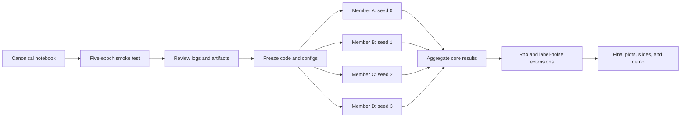

# Kế hoạch thực nghiệm đồ án CS2229 - Sharpness-Aware Minimization

## Material Passport

- Origin Skill: experiment-agent
- Origin Mode: plan
- Origin Date: 2026-10-23
- Verification Status: UNVERIFIED
- Version Label: code_plan_v1

## 1. Thông tin chung

- **Môn học:** CS2229
- **Quy mô nhóm:** 4 thành viên
- **Hạn báo cáo:** 30/11/2026
- **Bài báo:** Foret, Kleiner, Mobahi, và Neyshabur, *Sharpness-Aware Minimization for Efficiently Improving Generalization*, ICLR 2021
- **Paper:** [OpenReview](https://openreview.net/forum?id=6Tm1mposlrM) | [arXiv](https://arxiv.org/abs/2010.01412)
- **Code chính thức:** [google-research/sam](https://github.com/google-research/sam)
- **Sản phẩm tối thiểu:** slides, source code, demo và sự tham gia thuyết trình của các thành viên

## 2. Mục tiêu thực nghiệm

Nhóm xây dựng một pipeline thống nhất để tái lập có kiểm soát một phần thí nghiệm của paper, thay vì mỗi người phát triển một notebook hoặc chọn một dataset độc lập.

Thí nghiệm chính trả lời câu hỏi:

> Trên CIFAR-10, với cùng model, data pipeline và training recipe, SAM có đạt test accuracy và generalization gap tốt hơn SGD hay không, và chi phí thời gian cùng bộ nhớ thay đổi như thế nào?

Kết quả tốt cần có:

1. Một so sánh SGD và SAM chạy thành công trên CIFAR-10.
2. Kết quả tổng hợp từ nhiều seed, không chỉ chọn run tốt nhất.
3. Ít nhất một thí nghiệm mở rộng, ưu tiên ablation theo `rho` hoặc robustness với label noise.
4. Notebook demo có thể chạy lại một cấu hình nhỏ và đọc được checkpoint của run hoàn chỉnh.

## 3. Phạm vi thực nghiệm

### 3.1 Thí nghiệm lõi

| Thành phần | Thiết lập |
|---|---|
| Dataset | CIFAR-10 |
| Model ưu tiên | WideResNet-28-10 |
| Fallback nếu thiếu GPU | WideResNet-16-4 hoặc ResNet-18; phải ghi rõ đây là reduced reproduction |
| Augmentation | Horizontal flip, padding 4 pixels và random crop |
| Methods | SGD và SAM-SGD |
| Epochs | 200 |
| SAM radius | `rho = 0.05` |
| Seeds | 0, 1, 2, 3 |
| Primary metric | Test accuracy trung bình trên các seed |
| Metrics bổ sung | Train/test loss, train accuracy, generalization gap, wall-clock time, time/epoch và peak GPU memory |

WideResNet-28-10, CIFAR-10, basic augmentation và 200 epochs bám sát một condition trong Table 1 của paper. Nhóm dùng bốn seed để phù hợp với bốn thành viên. Nếu tài nguyên cho phép, chạy thêm seed 4 để tiến gần hơn protocol năm replica của paper.

### 3.2 Thí nghiệm mở rộng

Ưu tiên theo thứ tự:

1. `rho` ablation trên CIFAR-10.
2. Label noise 40%.
3. Label noise 80%.
4. SGD 400 epochs để có thêm một đối chứng gần equal-gradient-computation với SAM 200 epochs.
5. CIFAR-100 chỉ thực hiện khi toàn bộ thí nghiệm trên đã hoàn tất và artifact đã được kiểm tra.

Không chia mỗi thành viên một dataset trong thí nghiệm chính. Nếu mỗi dataset chỉ có một số cấu hình riêng, kết quả khó ghép thành một so sánh thống nhất.

## 4. Phân công bốn thành viên

Điền tên thật vào cột `Thành viên` trước khi bắt đầu chạy chính thức.

| Thành viên | Core runs bắt buộc | Extension phụ trách | Trách nhiệm bổ sung |
|---|---|---|---|
| A - [Tên] | SGD seed 0; SAM seed 0 | SGD 400 epochs seed 0 nếu còn tài nguyên | Duy trì canonical notebook, khóa phiên bản code và kiểm tra artifact |
| B - [Tên] | SGD seed 1; SAM seed 1 | SAM với `rho = 0.01, 0.1, 0.2`, seed 1 | Tổng hợp đồ thị `rho` ablation |
| C - [Tên] | SGD seed 2; SAM seed 2 | SGD và SAM với 40% label noise, seed 2 | Tổng hợp đồ thị learning curves |
| D - [Tên] | SGD seed 3; SAM seed 3 | SGD và SAM với 80% label noise, seed 3 | Tổng hợp bảng accuracy, thời gian và bộ nhớ |

### 4.1 Run matrix

| Run ID | Người chạy | Method | Seed | Rho | Label noise | Epochs | Mức ưu tiên |
|---|---|---|---:|---:|---:|---:|---|
| `core_sgd_s0` | A | SGD | 0 | 0 | 0% | 200 | Bắt buộc |
| `core_sam_s0` | A | SAM | 0 | 0.05 | 0% | 200 | Bắt buộc |
| `core_sgd_s1` | B | SGD | 1 | 0 | 0% | 200 | Bắt buộc |
| `core_sam_s1` | B | SAM | 1 | 0.05 | 0% | 200 | Bắt buộc |
| `core_sgd_s2` | C | SGD | 2 | 0 | 0% | 200 | Bắt buộc |
| `core_sam_s2` | C | SAM | 2 | 0.05 | 0% | 200 | Bắt buộc |
| `core_sgd_s3` | D | SGD | 3 | 0 | 0% | 200 | Bắt buộc |
| `core_sam_s3` | D | SAM | 3 | 0.05 | 0% | 200 | Bắt buộc |
| `rho_001_s1` | B | SAM | 1 | 0.01 | 0% | 200 | Mở rộng 1 |
| `rho_010_s1` | B | SAM | 1 | 0.10 | 0% | 200 | Mở rộng 1 |
| `rho_020_s1` | B | SAM | 1 | 0.20 | 0% | 200 | Mở rộng 1 |
| `noise40_sgd_s2` | C | SGD | 2 | 0 | 40% | 200 | Mở rộng 2 |
| `noise40_sam_s2` | C | SAM | 2 | 0.05 | 40% | 200 | Mở rộng 2 |
| `noise80_sgd_s3` | D | SGD | 3 | 0 | 80% | 200 | Mở rộng 3 |
| `noise80_sam_s3` | D | SAM | 3 | 0.05 | 80% | 200 | Mở rộng 3 |
| `compute_sgd400_s0` | A | SGD | 0 | 0 | 0% | 400 | Mở rộng 4 |

Các extension một seed chỉ được trình bày là kết quả khám phá. Không dùng chúng để khẳng định phương pháp tốt hơn một cách ổn định.

## 5. Canonical notebook

Nhóm chỉ duy trì một notebook nguồn, ví dụ:

```text
sam_reproduction.ipynb
```

Mỗi thành viên dùng cùng notebook và cùng phiên bản code. Chỉ thay đổi cell cấu hình:

```python
METHOD = "sam"          # "sgd" hoặc "sam"
DATASET = "cifar10"
MODEL = "wrn28x10"
SEED = 0
RHO = 0.05
LABEL_NOISE = 0.0
EPOCHS = 200
RUN_ID = "core_sam_s0"
```

Notebook phải có các phần:

1. Kiểm tra môi trường và GPU.
2. Cài đặt hoặc import dependency.
3. Khởi tạo config và seed.
4. Chuẩn bị CIFAR-10, validation split và augmentation.
5. Khởi tạo model.
6. Khởi tạo SGD hoặc SAM-SGD.
7. Training và validation loop.
8. Đánh giá test set từ checkpoint được chọn theo validation metric.
9. Xuất artifact chuẩn.
10. Demo load checkpoint và dự đoán một batch ảnh.

## 6. Chuẩn đầu ra của mỗi run

Mỗi run phải tạo đúng một thư mục:

```text
results/<run_id>/
  config.json
  history.csv
  summary.json
  best_checkpoint.pt
  learning_curves.png
  environment.txt
```

### 6.1 Nội dung tối thiểu của `summary.json`

- Run ID
- Method
- Dataset và model
- Seed
- Rho
- Label-noise rate
- Best validation accuracy
- Test accuracy tại checkpoint tốt nhất
- Final train accuracy và train loss
- Generalization gap
- Tổng thời gian training
- Thời gian trung bình mỗi epoch
- Peak GPU memory
- GPU name
- Framework và package versions
- Git commit hoặc notebook version

### 6.2 Quy tắc lưu kết quả

- Không chỉ lưu screenshot.
- Không ghi đè run cũ khi chạy lại.
- Không đổi tên cột CSV giữa các thành viên.
- Không chọn checkpoint bằng test accuracy.
- Không chỉ giữ run tốt nhất và bỏ run xấu.
- Mọi con số trên slide phải truy ngược được về `summary.json` hoặc `history.csv`.

## 7. Quy trình thực hiện



### Giai đoạn 1 - Hoàn thiện pipeline

Thành viên A chuẩn bị notebook. Các thành viên còn lại review config, output path và khả năng chạy lại.

### Giai đoạn 2 - Smoke test

Cả bốn thành viên chạy cấu hình được giao trong 5 epochs. Chỉ được chuyển sang full run khi:

- Notebook chạy từ đầu đến cuối mà không sửa thủ công giữa chừng.
- SGD và SAM dùng cùng data split và augmentation.
- Các file artifact được tạo đúng schema.
- Checkpoint load lại được.
- Training loss có xu hướng giảm.
- GPU memory không vượt giới hạn.
- Thời gian 5 epochs đã được dùng để ước lượng tổng thời gian 200 epochs.

Nếu WideResNet-28-10 không khả thi trên tài nguyên hiện có, cả nhóm cùng chuyển sang một model fallback. Không để mỗi thành viên tự chọn model khác nhau.

### Giai đoạn 3 - Đóng băng pipeline

Ghi lại phiên bản notebook hoặc commit. Sau thời điểm này, mọi sửa đổi ảnh hưởng training phải tạo version mới và các run cũ phải được đánh dấu rõ.

### Giai đoạn 4 - Chạy core matrix

Mỗi thành viên chạy cặp SGD và SAM với seed được giao. Ưu tiên hoàn thành đủ tám core runs trước khi chạy extension.

### Giai đoạn 5 - Tổng hợp core results

Tính mean và standard deviation trên bốn seed cho SGD và SAM. Kiểm tra run bất thường trước khi mở rộng thí nghiệm.

### Giai đoạn 6 - Chạy extension

Chạy `rho` ablation, label noise và SGD 400 epochs theo thứ tự ưu tiên trong Mục 3.2.

### Giai đoạn 7 - Khóa kết quả

Tạo bảng tổng hợp cuối, xuất hình dùng cho slides và chạy lại notebook demo từ đầu.

## 8. Nội dung kết quả cần đưa lên slides

### 8.1 Bảng kết quả chính

| Method | Test accuracy, mean ± SD | Generalization gap | Time/epoch | Total time | Peak memory |
|---|---:|---:|---:|---:|---:|
| SGD | Chưa chạy | Chưa chạy | Chưa chạy | Chưa chạy | Chưa chạy |
| SAM | Chưa chạy | Chưa chạy | Chưa chạy | Chưa chạy | Chưa chạy |

### 8.2 Hình bắt buộc

1. Learning curves của một cặp SGD/SAM dùng cùng seed.
2. Test accuracy trung bình của SGD và SAM trên bốn seed, kèm error bar.
3. Test accuracy theo `rho`.
4. Test accuracy của SGD và SAM tại 0%, 40% và 80% label noise.
5. Biểu đồ thời gian training hoặc accuracy theo GPU-hour nếu dữ liệu đủ.

## 9. Kế hoạch demo

Demo dùng chính canonical notebook:

1. Hiển thị config của một run.
2. Chạy SGD hoặc SAM trong 1-5 epochs với cấu hình demo nhỏ.
3. Hiển thị log training đang cập nhật.
4. Load checkpoint của một full run.
5. Hiển thị learning curve và dự đoán trên một batch CIFAR-10.
6. Chuyển `METHOD` giữa `sgd` và `sam` mà không sửa training loop.

Không phụ thuộc vào việc chạy đủ 200 epochs trong lúc thuyết trình. Full-run artifacts phải được chuẩn bị trước và demo chỉ chứng minh pipeline thực sự hoạt động.

## 10. Tiêu chí hoàn thành

### Mức tối thiểu

- Một notebook chạy được end-to-end.
- Ít nhất một run SGD và một run SAM trên CIFAR-10.
- Có checkpoint, learning curve và test accuracy.
- Demo load checkpoint và inference thành công.

### Mức tốt

- Đủ tám core runs trên bốn seed.
- Có mean ± standard deviation.
- Có thời gian training và peak GPU memory.
- Slides phân biệt rõ số từ paper và số do nhóm tự chạy.

### Mức điểm cao

- Hoàn thành core matrix và `rho` ablation.
- Có ít nhất một label-noise comparison hoàn chỉnh.
- Có SGD 400-epoch control hoặc một compute-aware comparison khác.
- Toàn bộ kết quả truy ngược được về config, log và checkpoint.
- Notebook demo chạy lại ổn định trên môi trường trình bày.

## 11. Checklist trước khi full run

- [ ] Đã điền tên bốn thành viên và xác nhận phân công.
- [ ] Đã chốt model dựa trên smoke-test runtime.
- [ ] Đã chốt validation split và không thay đổi giữa các run.
- [ ] Đã cố định seed cho data split, initialization và data loader.
- [ ] Đã kiểm tra SGD và SAM dùng cùng augmentation.
- [ ] Đã kiểm tra SAM dùng cùng mini-batch cho hai gradient evaluations.
- [ ] Đã kiểm tra BatchNorm running statistics không bị cập nhật sai ở pass thứ hai.
- [ ] Đã kiểm tra `rho=0` hoặc chế độ SGD thực sự tắt SAM perturbation.
- [ ] Đã kiểm tra checkpoint selection chỉ dùng validation metric.
- [ ] Đã kiểm tra `summary.json` và `history.csv` được tạo đúng.
- [ ] Đã test load checkpoint và inference.
- [ ] Đã khóa notebook version trước khi chia full runs.

## 12. Rủi ro và phương án xử lý

| Rủi ro | Dấu hiệu | Xử lý |
|---|---|---|
| Không đủ GPU cho WRN-28-10 | Smoke test dự báo tổng thời gian vượt ngân sách | Cả nhóm chuyển sang cùng WRN-16-4 hoặc ResNet-18 và ghi là reduced reproduction |
| Colab ngắt phiên | Run dừng giữa chừng | Lưu checkpoint định kỳ và hỗ trợ resume từ epoch gần nhất |
| Kết quả giữa thành viên không ghép được | Khác model, split hoặc package | Chỉ dùng canonical notebook và frozen config |
| SAM không tốt hơn SGD | Accuracy chênh lệch nhỏ hoặc ngược chiều | Báo cáo trung thực toàn bộ seed, kiểm tra pipeline và giới hạn kết luận trong setting đã chạy |
| Extension chưa hoàn thành | Core runs còn thiếu | Dừng extension và ưu tiên hoàn tất core matrix |
| Demo lỗi mạng | Không tải được dataset hoặc dependency | Cache dataset, dependency và checkpoint trước buổi báo cáo |

## 13. Tài liệu tham khảo

1. Foret, P., Kleiner, A., Mobahi, H., & Neyshabur, B. (2021). *Sharpness-Aware Minimization for Efficiently Improving Generalization*. International Conference on Learning Representations. https://openreview.net/forum?id=6Tm1mposlrM
2. Google Research. *SAM: Sharpness-Aware Minimization for Efficiently Improving Generalization*. https://github.com/google-research/sam
