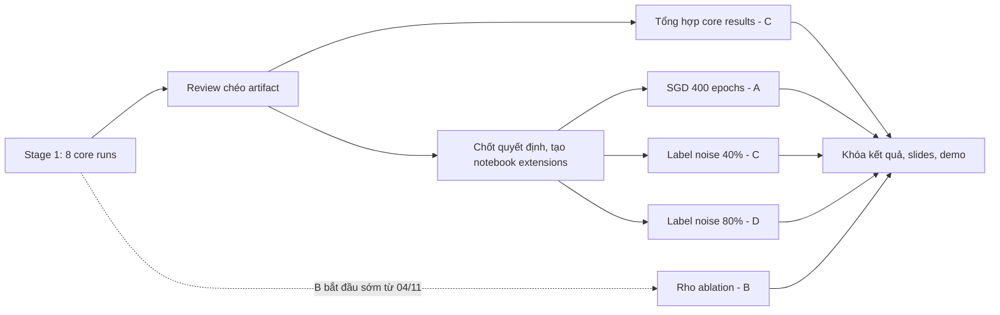

# Tổng quan thực nghiệm: stage 1 và stage 2

- **Ngày ghi:** 06/11/2026
- **Trạng thái:** 8 core runs của stage 1 đã chạy xong; số liệu chưa được review chéo và tổng hợp. Stage 2 mới có `rho` ablation của B đang chạy trên `run/rho-s1`.
- **Nguồn chính:** [`2026-10-23-sam-experiment-work-plan-vi.md`](2026-10-23-sam-experiment-work-plan-vi.md) (code_plan_v3). Note này tóm tắt và bổ sung, không thay thế work plan.

## 1. Bức tranh chung

Đồ án tái lập có kiểm soát một phần bài báo SAM (Foret et al., ICLR 2021) trên CIFAR-10 với WideResNet-28-10, 200 epochs. Mọi run dùng cùng notebook, cùng recipe và cùng validation split, nên kết quả của bốn thành viên ghép được thành một so sánh thống nhất.

| | Stage 1 - Core matrix | Stage 2 - Extensions |
|---|---|---|
| Câu hỏi | SAM có tốt hơn SGD không và tốn thêm bao nhiêu? | SAM tốt hơn vì sao, trong điều kiện nào, và có đáng chi phí không? |
| Số run | 8 (SGD và SAM × seed 0-3) | Tối đa 8 (3 `rho` + 1 SGD 400 epochs + 4 label noise) |
| Mức kết luận | Kết luận chính, mean ± SD trên 4 seed | Kết quả khám phá, mỗi cấu hình một seed |
| Vai trò | Baseline cho mọi so sánh | Phân tích sâu, cần cho mức điểm cao |

## 2. Stage 1 - Core matrix

### 2.1 Mục tiêu

Trả lời câu hỏi chính của đồ án:

> Trên CIFAR-10, với cùng model, data pipeline và training recipe, SAM có đạt test accuracy và generalization gap tốt hơn SGD hay không, và chi phí thời gian cùng bộ nhớ thay đổi như thế nào?

Bốn seed cho phép báo cáo mean ± SD để kết luận không phụ thuộc vào một run may mắn.

### 2.2 Việc cần làm khi có kết quả

1. **Review chéo artifact** (A↔C, B↔D) trước khi dùng bất kỳ con số nào: đối chiếu `config.json`, `history.csv` đủ 200 dòng, schema `summary.json`, `notebook_version = sam_reproduction_vi_v5` ở cả 8 run, và load được checkpoint. Run sai version hoặc thiếu artifact không được đưa vào tổng hợp.
2. **Bảng kết quả chính:**
   - Test accuracy mean ± sample SD cho SGD và SAM.
   - Chênh lệch `SAM - SGD` theo từng seed (paired, vì cùng seed thì cùng điều kiện).
   - Generalization gap. Notebook định nghĩa là accuracy trên train split với nhãn sạch, không augmentation, tại best checkpoint, trừ test accuracy.
   - Time/epoch, total time, peak GPU memory và tỷ lệ overhead của SAM, tách theo loại GPU (xem [`2026-11-06-core-s0-mixed-gpu-comparability-vi.md`](2026-11-06-core-s0-mixed-gpu-comparability-vi.md)).
3. **Hình:** learning curves của một cặp SGD/SAM cùng seed; paired plot SGD và SAM trên bốn seed kèm mean và error bar.
4. **Đối chiếu với paper:** đặt số của nhóm cạnh condition WRN-28-10, basic augmentation, 200 epochs trong Table 1 của paper. Phân biệt rõ số của paper và số nhóm tự chạy.
5. **Diễn giải trung thực:** bốn seed không đủ để dùng p-value. Báo cáo từng seed, mean và độ phân tán. Nếu SAM không hơn SGD, vẫn báo cáo đủ và giới hạn kết luận trong setting đã chạy.

### 2.3 Stage 1 là baseline cho stage 2

| Core run | Dùng trong stage 2 làm |
|---|---|
| `core_sgd_s1`, `core_sam_s1` | Đường tham chiếu SGD và điểm `rho = 0.05` của `rho` ablation |
| `core_sgd_s0`, `core_sam_s0` | Đối chứng cho SGD 400 epochs |
| `core_sgd_s2`, `core_sam_s2` | Điểm 0% noise của label-noise comparison |

Time/epoch đo được ở stage 1 cũng là căn cứ để kiểm tra lịch stage 2 còn khả thi trước ngày báo cáo 30/11.

## 3. Stage 2 - Extensions

### 3.1 Mục tiêu từng thí nghiệm

| # | Thí nghiệm | Câu hỏi | Run IDs | So với | Người chạy |
|---|---|---|---|---|---|
| 1 | `rho` ablation | SAM nhạy với `rho` đến mức nào; 0.05 có hợp lý trong setting của nhóm không? | `rho_001_s1`, `rho_010_s1`, `rho_020_s1` | `core_sgd_s1` (đường tham chiếu), `core_sam_s1` (`rho = 0.05`) | B, đang chạy |
| 2 | SGD 400 epochs | SAM hơn SGD có phải chỉ vì mỗi bước tốn gấp đôi gradient? SAM 200 epochs xấp xỉ SGD 400 epochs về số lần tính gradient. | `compute_sgd400_s0` | `core_sam_s0`, `core_sgd_s0` | A |
| 3 | Label noise 40% | SAM có bền hơn SGD khi nhãn train bị nhiễu? | `noise40_sgd_s2`, `noise40_sam_s2` | `core_sgd_s2`, `core_sam_s2` | C |
| 4 | Label noise 80% | Ở mức nhiễu nặng, khoảng cách SAM và SGD thay đổi thế nào? | `noise80_sgd_s2`, `noise80_sam_s2` | `core_*_s2`, `noise40_*_s2` | D |

Hình cần có cho slides:

- Test accuracy theo `rho`; SGD là đường ngang tham chiếu, không vẽ thành điểm "SAM `rho = 0`".
- Test accuracy của SGD và SAM ở 0%, 40% và 80% noise, cùng seed 2.
- So sánh SAM 200 epochs với SGD 200 và 400 epochs theo số lần tính gradient.

### 3.2 Quy tắc chung

- Mỗi extension chỉ có một seed nên chỉ được trình bày là **kết quả khám phá**, không dùng để khẳng định SAM tốt hơn một cách ổn định.
- Label-noise runs dùng chung seed 2 ở cả 0%, 40% và 80% để tách ảnh hưởng của noise rate khỏi khác biệt initialization.
- Thiếu tài nguyên thì bỏ CIFAR-100 trước, rồi bỏ label noise 80%. Không hy sinh tính nhất quán của pipeline để chạy thêm extension.

### 3.3 Hiện trạng notebook

| Notebook | Version | Hỗ trợ | Ghi chú |
|---|---|---|---|
| `notebooks/sam_reproduction_vi.ipynb` | `sam_reproduction_vi_v5` | `RUN_PLAN` thuộc `smoke`, `core` | Run ID có dạng `{RUN_PLAN}_{method}_s{SEED}`; `LABEL_NOISE`, `EPOCHS`, `METHODS` là hằng số recipe |
| `notebooks/sam_stage2_reproduction_vi.ipynb` | `sam_stage2_reproduction_vi_v1` | `RUN_PLAN` thuộc `smoke`, `rho`; chỉ chạy SAM | B đang resume trên `run/rho-s1` |

Label noise đã có sẵn trong pipeline (`NoisySubset`): symmetric noise, mỗi nhãn bị chọn được đổi sang một lớp khác ngẫu nhiên, xác định theo `SEED`. Noise chỉ áp lên train split; validation, test và phép đo train accuracy cho generalization gap dùng nhãn sạch. Cột `train_accuracy` trong `history.csv` được đo trong lúc train nên tính trên nhãn nhiễu.

Cosine schedule dùng `T_max = EPOCHS`, nên SGD 400 epochs có learning-rate schedule trải đều trên 400 epochs.

### 3.4 Notebook cho các extension còn lại (đề xuất, chưa chốt)

Không thể thêm plan mới vào notebook `rho` mà không tăng `NOTEBOOK_VERSION`, và tăng version sẽ làm resume của B trên `run/rho-s1` từ chối tiếp tục. Không thể dùng notebook core vì `RUN_PLAN` chỉ nhận `smoke` và `core`, và branch chỉ được khác `main` ở `RUN_PLAN` và `SEED`.

Đề xuất: tạo một notebook mới `notebooks/sam_stage2_extensions_vi.ipynb`, nhân bản từ `sam_reproduction_vi_v5`, giữ nguyên training code, chỉ thêm các plan:

| `RUN_PLAN` | Methods | Label noise | Epochs | Run IDs | Branch |
|---|---|---:|---:|---|---|
| `smoke` | SGD, SAM | 0% | 5 | `smoke_*` | `main` |
| `sgd400` | SGD | 0% | 400 | `compute_sgd400_s0` | `run/sgd400-s0` |
| `noise40` | SGD, SAM | 40% | 200 | `noise40_sgd_s2`, `noise40_sam_s2` | `run/noise40-s2` |
| `noise80` | SGD, SAM | 80% | 200 | `noise80_sgd_s2`, `noise80_sam_s2` | `run/noise80-s2` |

Notebook mới cần qua smoke test local (`tools/run_notebook_locally.py`, phải in `NOTEBOOK_OK`), kể cả kịch bản ngắt giữa run rồi resume. Với cùng seed, plan `smoke` của notebook mới phải cho `history.csv` trùng với notebook core, như đã làm với notebook `rho`.

## 4. Quyết định nhóm cần chốt trước khi tạo notebook

1. **`rho` cho label-noise runs.** Work plan dùng `rho = 0.05` cho cả 40% và 80%. Paper dùng `rho = 0.1` cho phần lớn mức noise và 0.05 ở mức 80% (xem [`2026-10-12-sam-paper-summary-vi.md`](2026-10-12-sam-paper-summary-vi.md), Mục 9.4). Giữ 0.05 thì nhất quán với core runs; theo paper thì gần protocol gốc hơn. Lựa chọn nào cũng phải ghi rõ trong báo cáo.
2. **Cơ sở so sánh cho SGD 400 epochs.** `core_sam_s0` chạy trên cả T4 và G4, nên không so `compute_sgd400_s0` với nó theo wall-clock hoặc GPU-hour. Chọn một trong hai: so theo số lần tính gradient, hoặc chỉ vẽ accuracy theo GPU-hour bằng dữ liệu G4.
3. **Clean validation trong label-noise runs.** Notebook chọn checkpoint bằng validation set nhãn sạch. Đây là giả định thuận lợi so với thực tế (thường không có validation sạch), cần nêu trong phần hạn chế.
4. **Người chạy và loại GPU.** Xác nhận A, C, D còn đủ quota GPU và dung lượng Drive (mỗi run WRN-28-10 khoảng 1,1 GB). Nên dùng cùng loại GPU trong một run nếu có thể và luôn kiểm tra cột `gpu_name`.
5. **Lịch.** Work plan đặt extensions vào 11-17/11 và slides từ 18/11. Ước lượng lại từ time/epoch thực tế của stage 1; SGD 400 epochs tốn khoảng gấp đôi một core SGD run.

## 5. Thứ tự thực hiện đề xuất

1. Review chéo 8 core runs và kiểm tra cột `gpu_name`.
2. Chốt các quyết định ở Mục 4.
3. Tạo `sam_stage2_extensions_vi.ipynb` trên `main`, smoke test local, rồi tạo ba branch run.
4. A, C, D chạy extension; B tiếp tục `rho` ablation.
5. Song song: C tổng hợp core results theo Mục 2.2.
6. Tổng hợp extension, khóa kết quả, làm slides và demo.
